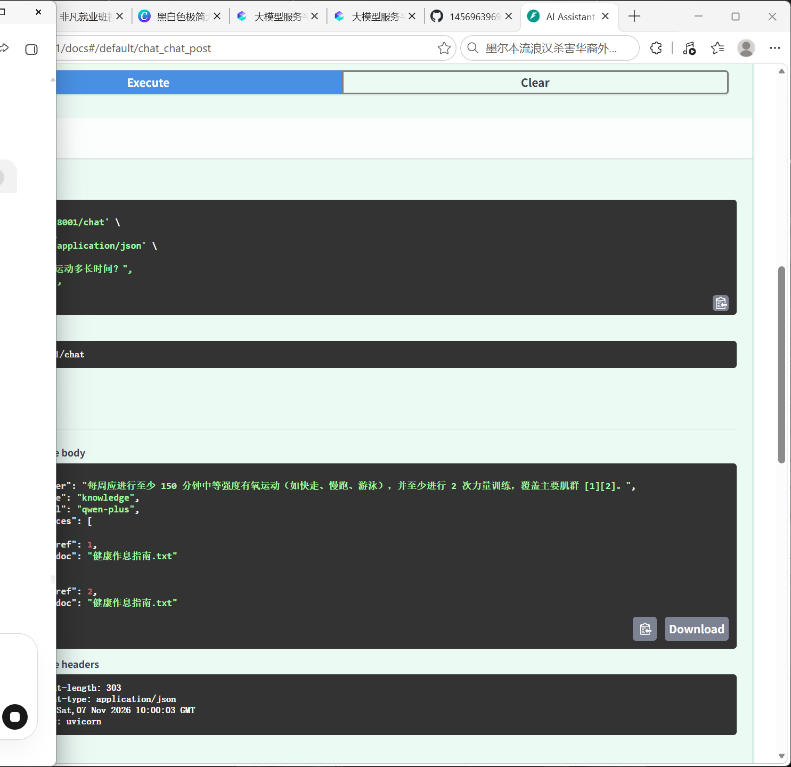

# AI Assistant — 基于 Agent 的私人 AI 助理服务

知识库优先、联网兜底的智能问答服务：意图路由 + 混合检索 + 重排 + 双层记忆 + 模型自动降级，答案强制附带来源引用。



## 架构

```
用户提问 (session_id)
   │
   ▼
Router 路由判断：闲聊问候 → 直接回复
   │              知识库命中（相关度 ≥ 阈值）→ 知识库检索
   │              命中不足且有 Tavily Key → 联网搜索兜底
   ▼
混合检索：向量检索（FAISS / Milvus）──┐
         BM25 关键词检索 ──────────┤→ RRF 融合 → BGE-Reranker 精排 → Top-5
   │
   ▼
双层记忆：短期（近 6 轮对话上下文）
         长期（PostgreSQL/SQLite 持久化全部会话）
   │
   ▼
答案生成：qwen-plus（主模型）→ 异常自动降级 deepseek-chat
   │
   ▼
返回 JSON：answer + route（本次路由）+ sources（来源文档）
```

## 核心模块

| 模块 | 说明 |
|---|---|
| Router 意图路由 | 按检索相关度阈值判断走知识库、联网还是直接回复，优先私有知识库 |
| 混合检索 | FAISS/Milvus 向量检索 + BM25 关键词检索，RRF 倒数排名融合 |
| 重排序 | 可选接入 SiliconFlow BGE-Reranker-v2-M3，对召回片段相关性精排 |
| 模型降级 | 主模型 qwen-plus 调用异常（超时/限流）自动切换 deepseek-chat 兜底 |
| 双层记忆 | 短期记忆维持近 6 轮上下文；长期记忆经 SQLAlchemy 落库（默认 SQLite，配 DATABASE_URL 即切 PostgreSQL） |
| 多源文档接入 | 支持 PDF / Word / Markdown / 网页 URL（`python app/ingest.py --url https://...`），Embedding 可切换 text-embedding-v2 或 BGE-M3（SiliconFlow） |
| Tool 工具化 | 知识库检索与联网搜索封装为 LangChain @tool 标准工具（app/tools.py），可无缝接入 LangGraph 等 Agent 编排扩展 |

## 快速开始

```bash
pip install -r requirements.txt
cp .env.example .env    # 至少填入 DASHSCOPE_API_KEY，其余可选

# 放入知识库文档到 data/ 目录，然后构建索引
python app/ingest.py

# 启动服务
python -m uvicorn app.main:app --reload
# 浏览器打开 http://127.0.0.1:8000/docs 调试
```

**可选配置（在 .env 中）：**
- `DEEPSEEK_API_KEY`：启用模型降级兜底
- `TAVILY_API_KEY`：启用联网搜索兜底（tavily.com 免费注册）
- `SILICONFLOW_API_KEY`：启用 BGE-Reranker 精排 / BGE-M3 Embedding（siliconflow.cn 免费注册）
- `VECTOR_STORE=milvus` + `MILVUS_URI`：向量库切换为 Milvus（默认 FAISS）
- `EMBEDDING_PROVIDER=siliconflow`：Embedding 切换为 BAAI/bge-m3

## 接口示例

```json
POST /chat
{"query": "每周应该运动多长时间？", "session_id": "u1"}

{"answer": "成年人每周应进行至少150分钟中等强度有氧运动，并配合每周至少2次力量训练 [1][2]。",
 "route": "knowledge",
 "model": "qwen-plus",
 "sources": [{"ref": 1, "doc": "健康作息指南.txt"}]}
```

知识库未命中且未配置联网时，回答「知识库中未找到相关内容」，不编造。

## 技术栈

Python · FastAPI · LangChain · FAISS/Milvus · rank_bm25 · BGE-Reranker · qwen-plus/DeepSeek · Tavily · SQLAlchemy
